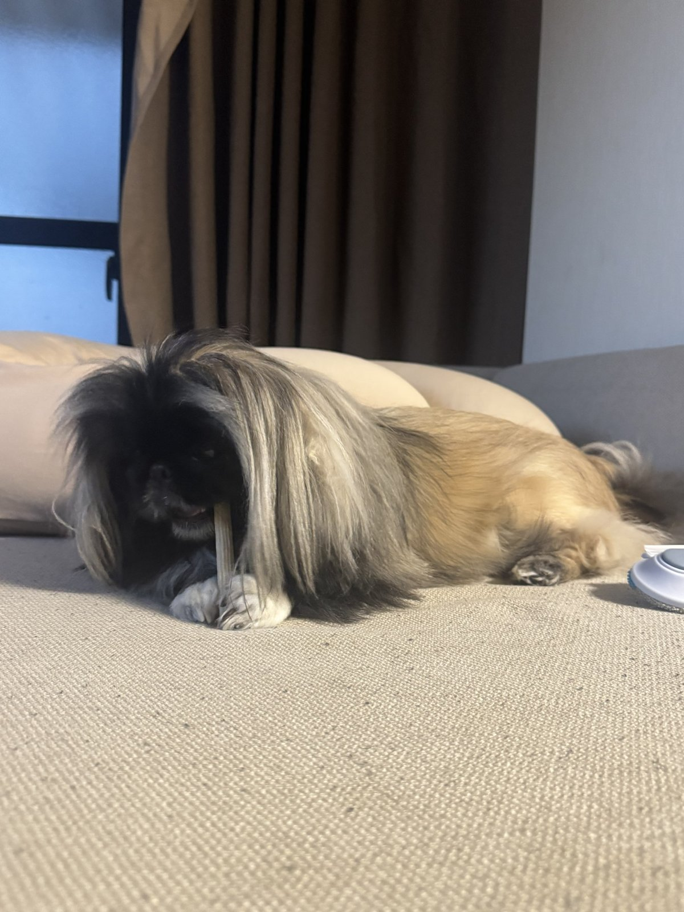

うちのペキニーズ、テン（5歳・女の子）は、カリカリ（ドライフード）をなかなか食べてくれません。
おやつのスティックは前足で押さえてかじるのに、ドライフードになると進まない。同じ悩みの方、たぶん少なくないと思います。

この記事は、「食べない理由を調べて、次に何を試すか決めたい」という飼い主目線のまとめです。
先に正直に書いておくと、ここで紹介するフードは**テンはまだ試していません**。公式サイトなどの情報をもとに「気になっている候補」として比べたものです。試したら、結果を別の記事で書きます。

## まず確認：「好き嫌い」か「体調」か

食べない理由を考える前に、ひとつだけ。

- 今まで食べていたのに、急に食べなくなった
- 元気がない、吐く、下痢をしている
- 水もあまり飲まない

こういうときは好き嫌いではなく、体調の問題かもしれません。フードを替える前に、まず動物病院に相談してください。

テンの場合は【社長へ：いつ頃から食べないか、体調面で気になることはないか、を一言（例：子犬の頃からずっと／病院で相談済み など）】。

## ドライフードを食べない理由として、よく挙げられるもの

いろいろ調べてみると、理由はだいたい次の4つに分かれそうです。

**1. におい・味が好みじゃない**
犬はにおいで食べるかどうかを決めることが多いと言われます。開けてから時間がたったフードは香りが弱くなりがちです。

**2. 粒の大きさ・形・硬さが合わない**
フードメーカーのロイヤルカナンは、ドライフードを食べずに遊んでしまう場合、粒が硬すぎる可能性にふれています。
ペキニーズのような鼻の短い犬種（短頭種）は、粒の形で食べやすさが変わるという話もよく見かけます。

**3. おやつでお腹がいっぱい**
好き嫌いのある犬向けのフードの公式ページにも「おやつはできる限り控える」と書かれていました。テンもおやつのスティックはかじっているので、ここは我が家も見直したいところです。

**4. ご飯の時間・環境**
出しっぱなしにしている、食べる場所が落ち着かない、なども理由として挙げられています。

## フードを替える前に試せる工夫

いきなり新しいフードを買う前に、今あるフードでできることもあります。

| 工夫 | やり方 | 気をつけること |
|---|---|---|
| ぬるま湯でふやかす | ぬるま湯をかけて数分おく | 熱湯は使わない。ふやかしたら早めに片づける |
| 少し温める | 人肌くらい（40℃前後）にする | 熱くしすぎない |
| ウェットを少し混ぜる | ドライにウェットを足す（ミックスフィーディング） | 合計のカロリーが増えないよう、ドライを減らす |
| おやつを見直す | ご飯の前はおやつをあげない | 急にゼロにせず少しずつ |

ウェットとの組み合わせについて、ロイヤルカナンの解説では、ドライとウェットは同じお皿で混ぜなくてもいい、同じタイミングでなくてもいい、とされていました。また、フードの切り替えは急にせず、少しずつ行うのが大事だそうです（急に変えるとお腹をこわすことがあるため）。

## 気になっている小粒・食べやすさ重視のフード3つ

ここからは「次に試すならどれか」を考えるための候補です。くり返しになりますが、テンはまだどれも食べていません。

### 1. ロイヤルカナン ミニ エクシジェント

**ロイヤルカナン ミニ エクシジェント**（気になっている）

- 公式の対象：「食事に好き嫌いがある小型犬（生後10ヵ月以上）」
- 粒：外はカリッと、中はやわらかい2層の粒。大きさ・形・硬さを小型犬が食べやすいよう工夫している、とのこと
- 内容量：800g／2kg
- メーカー調べで「99%の犬が食べた」という表示あり（あくまでメーカーの調査）

【商品リンク：ロイヤルカナン ミニ エクシジェント】

**よさそうな点**：名前のとおり「好き嫌いがある犬」向けに作られているので、悩みにいちばんまっすぐ合っていそうです。
**気になる点**：中がやわらかい粒が、テンの好みに合うかは試してみないとわかりません。

### 2. ロイヤルカナン エクストラ スモール アダルト

**ロイヤルカナン エクストラ スモール アダルト**（気になっている）

- 公式の対象：「生後10ヵ月齢以上の超小型犬成犬用」
- 粒：超小粒。メーカーは「嗜好性の高い」と説明
- 内容量：800g／1.5kg／3kg

【商品リンク：ロイヤルカナン エクストラ スモール アダルト】

**よさそうな点**：粒がとても小さいので、「粒の大きさが原因かも」という場合に試しやすそうです。
**気になる点**：好き嫌いのある犬向けとして作られたものではないので、においや味が原因なら合わないかもしれません。体重の目安が超小型犬向けなので、テンの体重に合うか確認が必要です。【社長へ：テンの体重を一言】

### 3. このこのごはん

**このこのごはん**（気になっている）

- 国産（九州の工場で製造、と紹介されています）
- 粒：8mm前後の平べったいクッキーのような形
- 小型犬向けとして紹介されることが多いフード
- 販売は公式サイト中心。価格は1kgで3,000円台（定期コースあり）。※執筆時点の第三者サイトの情報なので、最新の価格は公式サイトで確認してください

【商品リンク：このこのごはん】

**よさそうな点**：平たい粒は、鼻の短い子でもくわえやすそうな形です。
**気になる点**：1kgあたりの値段は、ほかの2つより高めです。食べなかった口コミもあるようなので、合う・合わないはやはり個体差がありそうです。

## 比べてみると

| | ミニ エクシジェント | エクストラ スモール アダルト | このこのごはん |
|---|---|---|---|
| 向いていそうな悩み | 好き嫌い全般 | 粒の大きさ | 粒の形・国産にこだわりたい |
| 粒 | 2層（中がやわらかい） | 超小粒 | 平たい小粒 |
| 買いやすさ | ペットショップ・通販 | ペットショップ・通販 | 公式サイト中心 |

テンの場合、カリカリを食べない理由がにおいなのか、粒なのか、まだはっきりしていません。
なので我が家は、まず**今のフードをふやかす・温める**を試して、それでもだめなら、好き嫌い向けの**ミニ エクシジェント**を少量から試してみるつもりです。
【社長へ：試す順番の希望があれば一言（このままでもOK）】

## まとめ

- 急に食べなくなったときは、まず病院へ
- フードを替える前に、ふやかす・温める・おやつを見直す
- 替えるなら「好き嫌い向け」「超小粒」「平たい粒」など、原因に合わせて選ぶ
- 切り替えは少しずつ

食べない子のご飯選びは、正解がひとつじゃないのが難しいところです。
テンが何を食べてくれたか、試したらまたこのブログで報告します。

---

テンの毎日の様子はnote（[note.com/bbbooouuu67](https://note.com/bbbooouuu67)）とInstagram（@tanukichi_tenten）で書いています。

**参考にした情報**
- [ロイヤルカナン ミニ エクシジェント（公式）](https://www.royalcanin.com/jp/dogs/products/retail-products/mini-exigent-1006)
- [ロイヤルカナン エクストラ スモール アダルト（公式）](https://www.royalcanin.com/jp/dogs/products/retail-products/x-small-adult)
- [ロイヤルカナン「愛犬のためのミックスフィーディング」](https://www.royalcanin.com/jp/dogs/health-and-wellbeing/mixed-feeding-your-dog)
- [エキサイト「このこのごはん」の紹介記事](https://www.excite.co.jp/petfood/konoko/)
