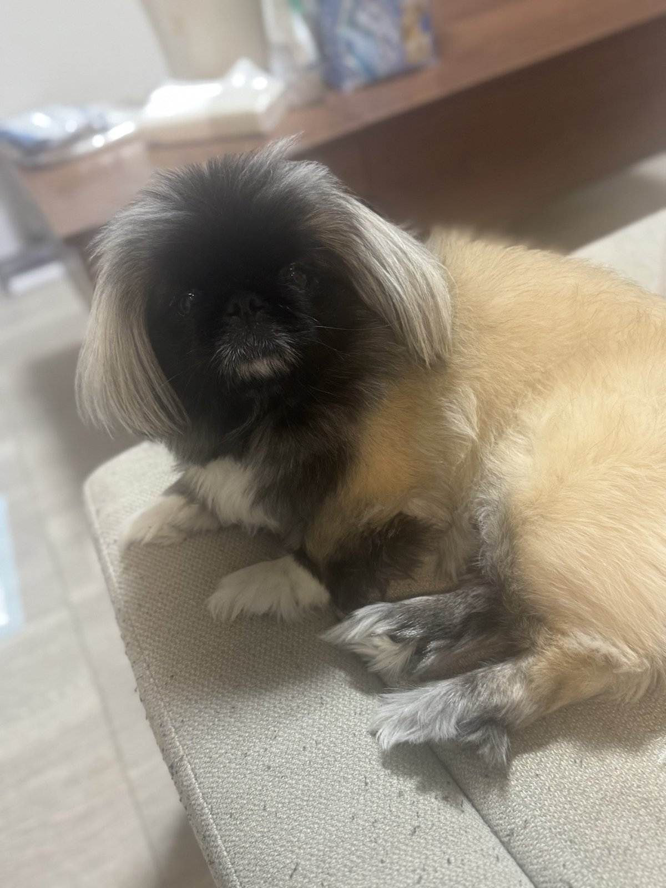
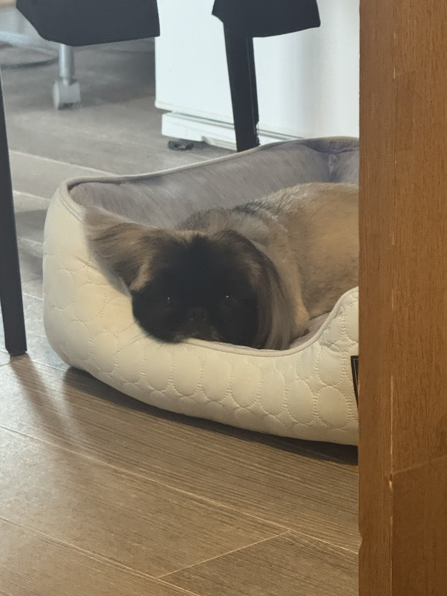

11月も後半になって、朝晩がぐっと冷えてきました。
うちのペキニーズ、テン（5歳・女の子）と暮らしていると、この時期に気になるのが「寒さ」と「乾燥」です。

ペキニーズは毛がふさふさなので、寒さには強そうに見えます。
でも、鼻の短い犬種（短頭種）ならではの気をつけたい点もあるようです。

この記事では、冬の寒さ・乾燥対策について調べたことを、飼い主目線のチェックリストにまとめました。
※この記事に広告リンクはありません。

## まず知っておきたいこと：短頭種と冷たい空気

ペキニーズのような短頭種は、冷たい空気の影響を受けやすいと言われています。

なので冬は「寒くないか」に加えて、「空気が冷たすぎたり、乾きすぎたりしていないか」も見てあげるのがよさそうです。

## 寒がっているサイン

ロイヤルカナンの解説では、犬が寒がっているサインとして、次のようなものが挙げられていました。

- ガタガタ震えている
- 体を丸めて縮こまっている
- 足を何度も持ち上げる
- 外にいると、しきりに家に戻ろうとする

目安として「飼い主が寒いと感じるなら、犬も寒がっているかもしれない」とも書かれています。
シンプルですが、いちばんわかりやすい基準だと思います。

## 部屋の中の寒さ対策チェックリスト

| チェック | ポイント |
|---|---|
| 温湿度計を置いている | 人の感覚ではなく、数字で確認する。犬がふだん過ごす場所の近くに置く |
| 暖房はエアコン中心 | 温度の管理がしやすい |
| ストーブ・ヒーターに近づけない | 近づきすぎるとやけどの危険がある |
| 湯たんぽはタオルで包む | 直接ふれると低温やけどのおそれがある |
| 毛布は厚すぎないもの | 厚すぎると湿気がこもり、皮膚トラブルの原因になることがある |
| 寝床は暖かく、でも蒸れないように | ドーム型ベッドは暖かいが、通気性と清潔さに気をつける |

テンは床に置いたクッション型のベッドで丸くなって休むことがあります。
冬はベッドの置き場所を、窓ぎわや床の冷えやすい場所から少し離すだけでも違いそうです。

## 乾燥対策チェックリスト

暖房をつけっぱなしにすると、部屋はかなり乾燥します。
乾燥は、皮膚や呼吸器（のどや鼻）の負担になることがあるそうです。

- **加湿器を一緒に使う**（加湿器のコードやタンクを、犬がいたずらできない場所に）
- **ブラッシングをする**：乾燥する季節は、皮膚のためにもブラッシングが役立つとされています。ペキニーズは毛が長いので、毛玉防止にもなります
- **保湿スプレーを使う**：犬用の保湿スプレーという選択肢もあります
- **飲み水はぬるめに**：冷たい水より、ぬるめの水のほうが飲みやすい子もいます

## 目のことも、いつもより気にしておく

ペキニーズは目が大きく、傷つきやすい犬種と言われます。
乾燥する季節は、目の様子もいつもより気にしておきたいところです。

- 目やにが増えた
- 目をしょぼしょぼさせる、こする
- 目が赤い、白くにごって見える

こんな様子があれば、早めに動物病院に相談してください。目のトラブルは、様子を見ているうちに悪くなることもあるので、自己判断はしないのがいちばんです。

## 冬の散歩で気をつけること

- **日中の暖かい時間に行く**
- **寒い日はコートやセーター**：小型犬や毛の短い子には、セーターなどが役立つことがあるそうです。雨や雪の日は撥水する素材がよいとされています
- **とても寒い日は短めに**
- **帰ったら体をふいて、温める**
- **足裏も確認**：雪道や凍った道を歩いたあとは、足裏や耳をチェックすると安心です

## まとめ

- 短頭種は冷たい空気の影響を受けやすい。寒さと一緒に乾燥にも気をつける
- 部屋は温湿度計で数字を見る。暖房器具のやけどに注意
- 加湿・ブラッシング・ぬるめの水で乾燥対策
- 目の様子がいつもとちがえば、早めに病院へ

テンと一緒に、今年の冬も元気に乗り切りたいと思います。
冬のグッズについても、また別の記事でまとめる予定です。

---

テンの毎日の様子はnote（[note.com/bbbooouuu67](https://note.com/bbbooouuu67)）とInstagram（@tanukichi_tenten）で書いています。

**参考にした情報**
- [ロイヤルカナン「寒い季節の愛犬のケア」](https://www.royalcanin.com/jp/dogs/health-and-wellbeing/caring-for-your-dog-in-cold-weather)
- [アットホーム「犬の寒さ対策」](https://www.athome.co.jp/contents/withpet/cold-protection-dog/)
