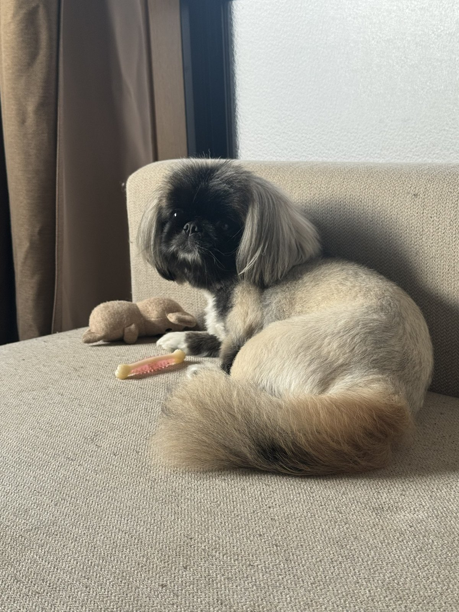

ペキニーズのテン（5歳・女の子）のおもちゃを探しはじめて、まず気になったのが「鼻の短い犬に合うおもちゃって、ふつうの犬と何かちがうの？」ということでした。

調べてみると、おもちゃそのものよりも「選ぶときの安全」と「遊ばせ方」に、短頭種ならではの気をつけたい点がありました。
この記事では、調べたことを飼い主目線のチェックリストにまとめます。
※この記事に広告リンクはありません。

## おもちゃ選びの基本チェックリスト

ペット用品メーカーのペティオの解説をもとに、選ぶときのポイントを整理しました。

| チェック | ポイント |
|---|---|
| 「犬用」と書いてあるか | 人間の子ども用のおもちゃは、犬がかむとこわれやすく危険とされています |
| 体の大きさに合った表示か | 体に対して小さすぎるおもちゃは、かむより口に入れてしまい、誤飲の原因になることがあります |
| 強度がしっかりしているか | 犬はかむ力・ふり回す力が強いので、素材と作りを見て選ぶ |
| こわれていないか定期的に見る | 傷んだおもちゃは、かけらの誤飲やケガにつながります。不安なら使わない・捨てる |
| 遊んだあとは片づける | 出しっぱなしにせず、目の届くところで遊ばせる |
| 洗えるか | 唾液で汚れるので、こまめに洗ってよく乾かすのがすすめられています |

## 短頭種ならではの「口の形」の話

ペキニーズのような鼻の短い犬種は、口元もコンパクトです。
ここからは調べた情報ではなく飼い主としての考えですが、

- 大きすぎるボールや太いロープは、くわえにくそう
- でも小さすぎると誤飲が心配

なので、「くわえやすいけど、口に全部は入らない大きさ」を目安に選びたいと思っています。
迷ったら、実物を見て、テンの口の大きさと比べてから決めるつもりです。

## 遊ばせ方で気をつけたいこと

おもちゃ選びより、むしろ大事なのはこちらかもしれません。

短頭種は、鼻やのどの作りの関係で呼吸がしにくく、パンティング（口を開けてハアハアする呼吸）で体温を下げるのも得意ではないと言われています。
獣医師が監修する海外の解説（PetMD、タフツ大学）でも、短頭種は暑さに弱く、熱中症のリスクが高いと書かれていました。

そこで、遊ばせ方のチェックリストです。

- **長く走り回らせない**：長い運動より、短い遊びを何回かに分ける
- **暑い時間・暑い部屋では遊ばない**：夏は涼しい時間帯や、エアコンの効いた部屋で
- **息が荒くなったら休憩**：水を用意しておく
- **体重管理も大事**：太りすぎは暑さのリスクを上げ、呼吸にも負担になるとされています

### こんな様子が見えたらすぐ中止

- ハアハアがおさまらない、呼吸がとても速い
- ぐったりしている、ふらつく
- 歯ぐきが赤い、よだれが多い、吐く

熱中症の可能性があります。涼しい場所に移して水を飲ませ、すぐ動物病院に連絡してください。

## テンに合いそうなおもちゃのタイプ

この条件で考えると、テンには次のようなタイプが合いそうです（まだ試していないので、あくまで候補です）。

- **知育おもちゃ**（おやつを中に入れて、転がしたり鼻で押したりすると出てくるもの）：走り回らずに、頭を使って遊べる
- **くわえやすい大きさのぬいぐるみ**：こわれにくい作りのもの
- **かじるタイプのおもちゃ**：スティックのおやつをかじるのは好きそうなので

知育おもちゃは、ご飯の一部を入れて使う人もいるそうです。カリカリを食べないテンが「遊びながらなら食べる」なら、うれしいのですが。
試したら、また結果を書きます。

## まとめ

- 「犬用」表示・体に合ったサイズ・強度を確認する
- こわれていないか定期的にチェック。遊んだら片づける
- 短頭種は長く激しい遊びより、短い遊びを何回か
- 暑さと呼吸の様子に注意。おかしいと思ったらすぐ中止して病院へ

ペキニーズと暮らしている方の「うちはこれで遊んでいます」という話も、noteのコメントなどで聞かせてもらえたらうれしいです。

---

テンの毎日の様子はnote（[note.com/bbbooouuu67](https://note.com/bbbooouuu67)）とInstagram（@tanukichi_tenten）で書いています。

**参考にした情報**
- [ペティオ「子犬のおもちゃの選び方」](https://www.petio.com/useful/puppy_toy)（子犬向けの解説ですが、選び方の基本は成犬にも当てはまります）
- [PetMD "Summer Safety Tips for Flat-Faced Dog Breeds"](https://www.petmd.com/dog/general-health/summer-safety-tips-for-flat-faced-dog-breeds)
- [Tufts Now "Do English bulldogs and other short-snouted dogs need special care in the summer heat?"](https://now.tufts.edu/2016/06/26/do-english-bulldogs-and-other-short-snouted-dogs-need-special-care-summer-heat)
