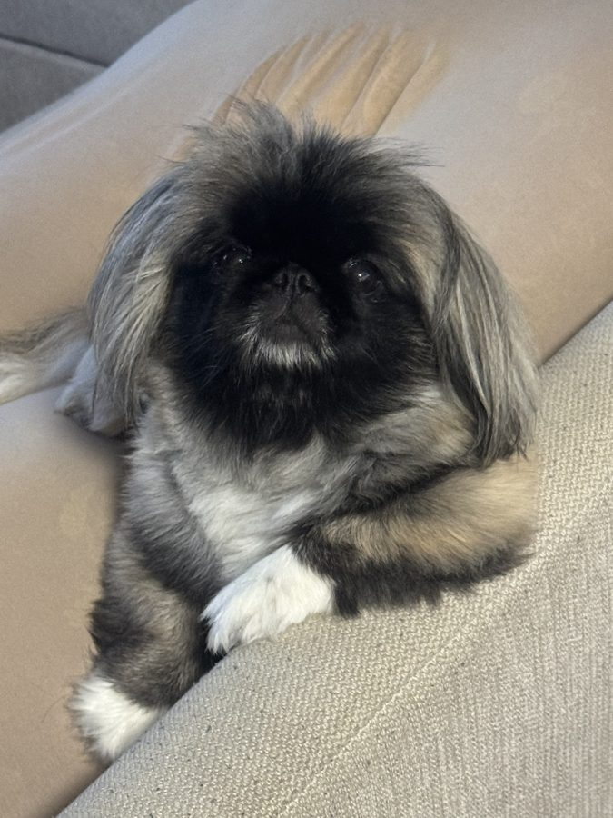

ペキニーズの「テン」と暮らしている藤村です。

テンは2021年9月29日生まれの女の子。人懐っこくて、とくに女の人が大好きです。ほとんど吠えません。ただ、ドライフードをなかなか食べてくれないのが、ずっと続いている悩みです。

このブログでは、テンのごはん・おやつ選びで試したことや、使ってみたグッズを記録しています。実際に使ったものは「使った」、使っていないものは「気になっている」「比べてみた」と分けて書きます。同じようにごはんで悩んでいる飼い主さんの参考になればうれしいです。

## noteもやっています

日々のことや、テンとの暮らしはnoteにも書いています。

[noteを見る](https://note.com/bbbooouuu67)

## テンの動画はSNSで

毎日のテンの様子を、短い動画でのせています。

- Instagram：[@tanukichi_tenten](https://www.instagram.com/tanukichi_tenten/)
- TikTok：[@ten.ten123](https://www.tiktok.com/@ten.ten123)
- YouTube：[@tanukichi_tenten1362](https://www.youtube.com/@tanukichi_tenten1362)

## お問い合わせ

メール：bbbooouuu67@gmail.com
